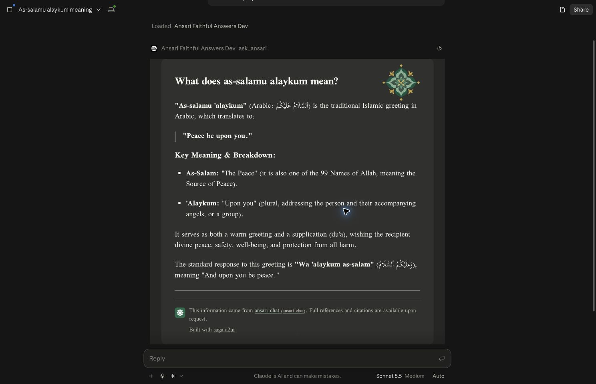

# 301: Review and verification

Destination build, typechecking, 19 server/packaging tests and 47 Chromium checks passed. Frozen installation of the application dependency closure passed. All seven existing lockfile importers are preserved byte-for-byte, and existing dependency snapshots are retained; new entries are additive. Public CI verifies both the destination lockfile and a fresh standalone resolution.

Independent Codex static consultation found no blocking integration defects. It verified runtime Turbo environment declarations, package-relative container paths and preserved existing development services. Its observation that isolated CI alone did not exercise the root lockfile was addressed by adding explicit frozen-lockfile application verification.

The destination's esbuild override resolves a newer patch than the source application. Its synthetic host harness now explicitly targets current Chromium (`esnext`); the production view build is unchanged. The browser suite passes with this harness setting.

Claude and Gemini consultation were not completed; the three-model ASPIR consultation is incomplete. Independent Codex review is recorded separately and does not represent those missing reviews. Upstream merge remains a maintainer decision.

Fresh public-only isolated installation, build, typecheck, 19 server tests, 47 browser checks, uncached Docker build and no-network/no-mount runtime smoke all passed. The runtime smoke verifies one tool/current resource, complete answer preservation, safe failure and recovery, content-addressed HTML and graceful shutdown.
## Destination-branch host verification

The app from commit `ef6b9724a8bb8541fecbf37dc5a21449b8e2e920` was built using the four public `@saga-a2ui/*@0.5.4-rc.1` packages and deployed to DEV. On 2026-10-21, representative synthetic greeting answers rendered in ChatGPT, Claude and the Alexa+ simulator. Each rendered document reported the exact destination revision, version `0.12.7`, and loaded Kitab regular and bold fonts. Complete answer text, Ansari attribution and the separate “Built with saga a2ui” footer were present.

Alexa's actual cached HTML matched the served resource byte-for-byte: 1,682,873 bytes, SHA-256 `be4f0c0e1b67ccd37b40770c8247b3d1f3230ff38113a59cd0523ccb73af33c2`.

These screenshots establish rendering, not reliable first-load behavior. ChatGPT initially failed to display the card and recovered with one embedded retry. Claude required reconnecting its existing connector after a discovery failure, then displayed an embed error; it eventually rendered after the retry/native reload sequence. Alexa delivered the correct HTML fragment promptly but rendered several minutes later without another question or deployment. The cause of these startup delays/failures is unproven. The reported regular-DEV mobile failure remains unresolved; working RC and Host QA mobile screenshots do not establish destination-build mobile acceptance.

### ChatGPT

### Claude

### Alexa+

## Footer repair (0.12.8)

The attribution now uses the answer's supplied separator when present, keeping its own border only when no separator is supplied. Successful link requests remain silent, unavailable-link destinations appear in distinct readable notices, and the framework signature aligns right. The original answer text and link policy are unchanged.

Destination typechecking, build, all 19 server/packaging tests and 55 browser checks passed. Browser checks cover both footer links, supplied/absent separators, 375px and 760px layout, unavailable host capability and light/dark notice contrast. Development deployment and actual-host verification are recorded separately from these local checks.

## Stateless Hono HTTP hosting

The HTTP listener now uses Hono and the official MCP request handler. A separate Hono project was generated with the SAGA CLI (`init --a2ui-stack lit-mcp --server hono`) as the adapter reference; the existing React view and its policy remain in place. The final stamped HTML and its SHA-256 URI are prepared before listening and reused across independent request servers. The old session map, expiry sweeper, replay store and per-call lifetime proxy are removed.

New regressions first failed against the previous listener (session-free discovery returned 400 and HTML had not been prepared at listen time), then passed with the new implementation. App 0.12.9 passes typechecking, build and 17 server/packaging tests. The fresh public-only isolated install passes the same checks and 55 browser checks, then an uncached Node 22 Docker build and no-network/no-mount runtime smoke: modern session-free calls, exact resource hash, unchanged answer/attribution, safe failure/recovery and clean shutdown. The root frozen offline install also passes; unrelated lockfile importers and snapshots are preserved.

This new transport has not been deployed or qualified in actual hosts. Earlier host captures above describe their named historical revision. The pending deployment retry for the older session-based footer build was retired because this migration supersedes it. No upstream merge or package publication is included.

## Standard application workspace placement

The standalone package now lives at `apps/ansari-faithful-answers`, using the repository's existing `apps/*` enrollment. The extra `app/*` enrollment is removed. The root lockfile change only renames this package's importer: dependency declarations, unrelated importers and all package snapshots are unchanged. All 58 tracked package files moved, with 56 non-documentation files preserved byte-for-byte. CI, current setup instructions and architecture/spec/plan references use the new location. The walkthrough points to that location and retains historical source links at their original immutable revision.

Fresh qualification from the relocated package passed: root frozen offline installation, frozen application-filtered installation with Node 22, package selection, typecheck, build, all 24 server/packaging tests and 55 browser checks. The public-only isolated installation passed the same application checks, followed by an uncached Node 22 Docker build and no-network/no-mount runtime smoke. The smoke verified complete answer preservation, safe failure/recovery, content-addressed HTML and graceful shutdown. Existing root development commands and package-relative Docker context are unchanged.

Separate independent Codex requirements and standards reviews found no actionable issues in the migration. Placement assertions failed against the old directory before the move and passed afterward; walkthrough JavaScript syntax and historical source targets were also checked. This path correction does not establish a new deployment or actual-host acceptance. The existing upstream contribution remains open for maintainer review; no merge, deployment or package release is included.
